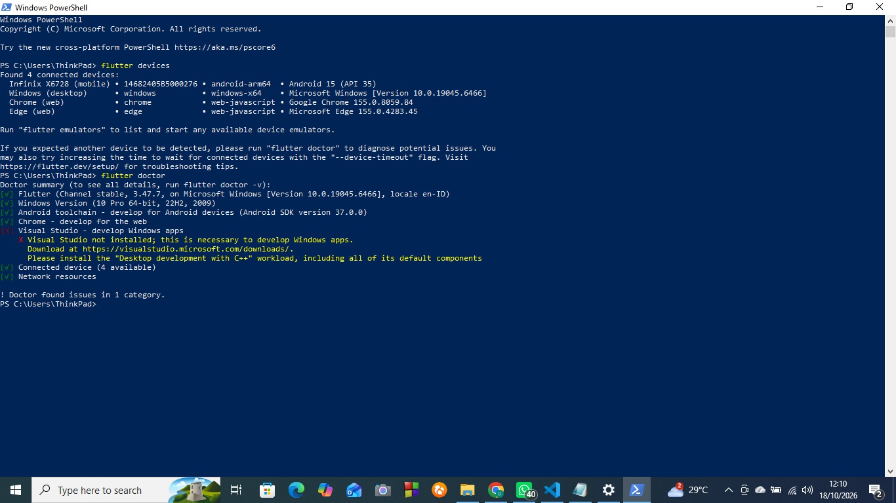
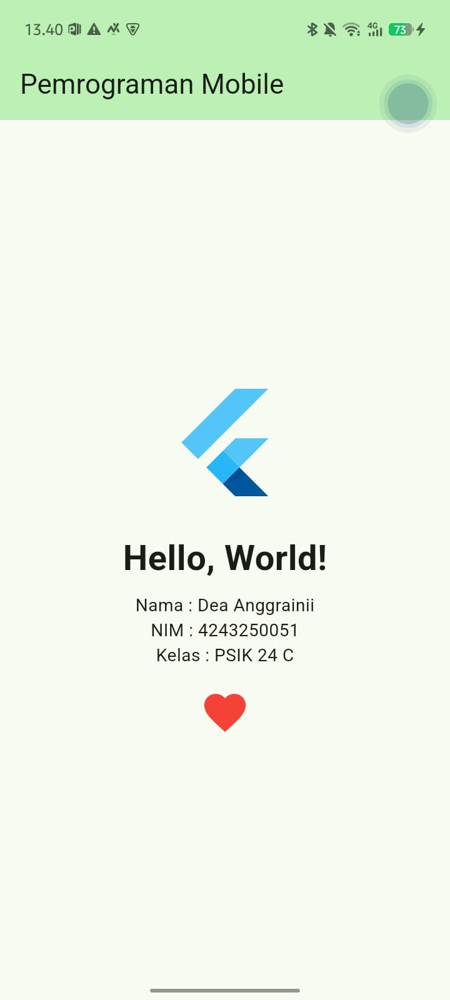

# Pertemuan 1: Setup Environment & Hello World Flutter

## Identitas
- Nama : Dea Anggraini
- NIM : 4243250051
- Kelas : PSIK 24 C

## Versi Flutter
```
Flutter 3.47.7 • channel stable • https://github.com/flutter/flutter.git
Framework • revision abaf9c5237 (10 days ago) • 2026-10-08 09:51:21 -0700
Engine • hash d8a2d6c768c334d53e16277f837970ffa1e2de81 (revision deb287481e) (10 days ago) • 2026-10-07 17:09:12.000Z
Tools • Dart 3.13.5 • DevTools 2.60.0
```

## Hasil flutter doctor


## Aplikasi Berjalan di Perangkat
Perangkat: Infinix X6728 (Android 15)



## Kendala dan Solusi
1. **Disk C hampir penuh.** (tulis dengan kata-kata sendiri bagaimana Anda memindahkan SDK, cache Gradle, dan Android SDK ke drive D)
2. **Build pertama gagal karena NDK tidak terpasang otomatis.** (tulis apa yang Anda lihat di log dan bagaimana Anda memasang NDK lewat SDK Manager)

## Pernyataan Penggunaan AI
(jelaskan jujur: AI dipakai untuk membantu instalasi dan membaca pesan error, dan apa yang Anda pelajari)

## Esai: Native, Hybrid, dan Cross-platform
(150-250 kata, kata-kata Anda sendiri)